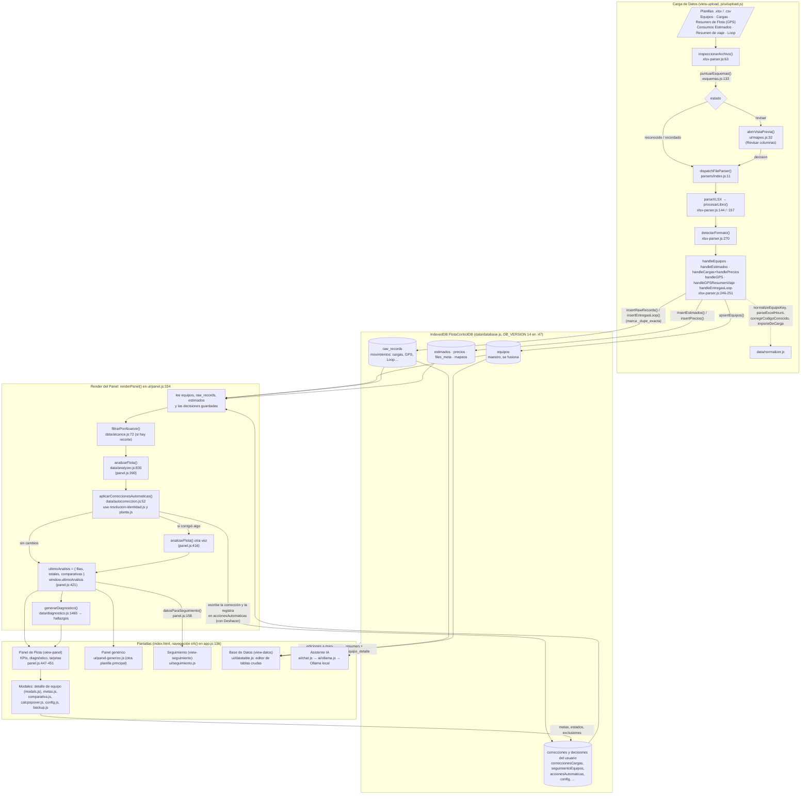

# Mapa del repo

Para que una sesión nueva entienda FlotaControl (repo `NEW-APP`) sin perder el hilo: **por dónde
entran los datos, dónde se guardan, quién los calcula, qué pantalla los muestra, qué archivo es
dueño de qué y qué tocar para cada cambio común**. Verificado contra el código el 16/10/2026
(`origin/main` en `f147fe9`); las referencias `archivo:línea` son de esa fecha y se corren con
cualquier edición: usalas para ubicarte, no como verdad eterna.

Este mapa **no repite** el por qué de cada cosa. Eso vive en:

- [`CLAUDE.md`](../CLAUDE.md): invariantes, decisiones cerradas, trampas ya pagadas, arneses.
- [`README.md`](../README.md): qué es la app, uso, cómo se decide L/hora vs L/100km.
- [`docs/FASE-7-IMPORTACION.md`](FASE-7-IMPORTACION.md), [`docs/DEPLOYMENT.md`](DEPLOYMENT.md) y
  las demás `docs/FASE-*.md`: el detalle de cada fase.
- `.claude/skills/`: las reglas que una sesión tiene que cargar antes de tocar cálculos
  (`calculos-combustible`, `flotacontrol-reglas-negocio`), importación
  (`flotacontrol-importacion`), vistas (`flotacontrol-nueva-vista`) o gráficos
  (`flotacontrol-graficos`), y el ciclo de entrega (`ciclo-de-entrega`).

Antes de concluir que algo "no existe", confirmá el repo con `git remote -v`: hay un repo
hermano (`flotacontrol`, en Vercel) con otra historia. Ver la tabla del principio de `CLAUDE.md`.

## 1. El flujo de los datos

Todo corre en el navegador, sin build ni backend. La única salida de red opcional es el
asistente, que habla con Ollama en `127.0.0.1:11434`.

Puntos que no se ven leyendo un solo archivo:

- **El análisis no se guarda.** Se recalcula entero en cada `renderPanel()`, que corre cada vez
  que se entra al Panel (`app.js:144`) y después de cada acción del usuario. Lo único persistente
  son los datos crudos y las decisiones (correcciones, estados, metas, recortes).
- **La autocorrección corre dentro del render**, entre dos pasadas de `analizarFlota()`: primero
  se analiza para encontrar huérfanos, se corrige lo que no tiene ambigüedad y, si algo cambió,
  se vuelve a analizar con la base ya corregida (`panel.js:390-416`).
- **Orden de procesamiento de archivos** (`upload.js:229`): primero los formatos reconocidos,
  después los recordados (mapeo guardado en `mapeos` por firma de encabezados), al final los que
  piden revisión. Así la planilla global de cargas ya está guardada cuando se mide la
  superposición de un reporte de estación (`superposicionConCargas()`, `xlsx-parser.js:108`).
- **"Reemplazar los movimientos ya cargados"** viene tildada: al procesar, `upload.js:208` llama
  a `clearMovimientos()` antes de importar. El maestro (`equipos`) y las decisiones no se borran.
- **Los "Resumen de viaje" son `solo_comparativa`**: no suman km ni horas, se cruzan contra el
  mensual (`resumen_vs_flota`). Ver `CLAUDE.md`.
- **El Service Worker** (`sw.js`, `CACHE_VERSION` en `:16`, `PRECACHE` en `:18`) pide JS/CSS a la
  red primero y cae al caché sin conexión. Si una prueba en el navegador no refleja tu cambio, es
  caché antes que código: ver "El caché te va a mentir" en `CLAUDE.md`.
- **Variables globales de puente** que publica `app.js:47-75` para que los módulos de UI se
  llamen sin importarse en círculo: `window.renderPanel`, `window.irA`,
  `window.abrirTablaConBusqueda`, `window.irAPanelConBusqueda`, `window.showDataTable`.

## 2. Qué archivo es dueño de qué

### Arranque y páginas

| Archivo | Dueño de |
|---|---|
| `index.html` | La única página: las cuatro vistas (`view-upload :70`, `view-panel :98`, `view-seguimiento :152`, `view-datos :171`), botones globales y la CSP. |
| `js/app.js` | Arranque (`initDB`, `init*`), navegación `irA()` (`:136`), botón "Vaciar datos" (`reanalizar()`, `:96`), registro del SW, globales de puente. |
| `sw.js` | Caché offline de la PWA. **Todo archivo nuevo de `js/` o `styles/` va en `PRECACHE`** (lo exige `tests/configuracion.test.mjs`). |
| `manifest.webmanifest`, `icons/` | Instalación como PWA (`tools/generar-iconos.cjs`). |
| `xlsx.full.min.js`, `vendor/` | SheetJS y Font Awesome locales. Ningún CDN externo. |

### Importación (`js/parsers/` + `js/ui/upload.js` + `js/ui/mapeo.js`)

| Archivo | Dueño de |
|---|---|
| `js/parsers/esquemas.js` | Qué campos entiende la app de cada tipo de planilla (`ESQUEMAS :26`), sinónimos de encabezado, puntaje contra cada esquema (`puntuarEsquemas :133`), firma (`firmaEncabezados :158`) y formato de columna (`detectarFormatoColumna :177`). Las claves de `campos` son las mismas que leen los `handle*`. |
| `js/parsers/xlsx-parser.js` | Lectura con SheetJS, detección de tipo (`detectarFormato :270`), un `handle*` por tipo (`:452-799`), identidad de fila con correcciones confirmadas (`:411-430`), importe recompuesto (`importeDeCarga :579`). Es el que escribe en IndexedDB. |
| `js/parsers/index.js` | Despacho por extensión (`dispatchFileParser`). |
| `js/ui/upload.js` | Pantalla Carga de Datos: cola de archivos, orden de procesamiento, casilla "Reemplazar", estado de la base (`renderDBStatus :153`). |
| `js/ui/mapeo.js` | Vista previa "Revisar columnas antes de importar" y decisión ante superposición. |

### Modelo de datos

| Archivo | Dueño de |
|---|---|
| `js/data/database.js` | **Único** acceso a IndexedDB: los 19 stores y su `DB_VERSION` (`:47`, solo sube y solo agrega stores), fusión del maestro (`upsertEquipos :224`, respeta `editado_manual`), dedupe exacto (`insertRawRecords :359`), fusión de Loop por remito (`insertEntregasLoop :484`), huella estable de cargas (`huellaCarga :165`), backup (`exportarBackup :991` / `importarBackup :1040`). |
| `js/data/normalizer.js` | Identidad y parseo: `normalizeEquipoKey` (`:289`, única fuente de verdad de la clave), `getDenominacion` (`:166`), `TIPO_POR_PREFIJO` (`:14`), `corregirCodigoConocido` (`:359`), `parseExcelHours` (`:689`), centros de costo y provincias. |

### Cálculo y reglas de negocio

| Archivo | Dueño de |
|---|---|
| `js/data/analyzer.js` | Reglas de cálculo por prefijo (`RULE_L_100KM`, `RULE_L_HORA`, `RULE_NO_TANK`, `:18-25`), índice del maestro (`indexarMaestro :38` / `resolverEquipo :50`), meses de un registro (`mesesDeRegistro :254`), meses completos por fuente (`:338`), alineación de períodos (`alinearCargasYGps :360`), jornadas (`JORNADA_REFERENCIA :417`), métricas por equipo (`calculateMetrics :569`) y el análisis de toda la flota (`analizarFlota :830`). |
| `js/data/diagnostico.js` | El motor de hallazgos (`generarDiagnostico :1465`) y las definiciones únicas que se importan, nunca se reescriben: `mediana :67`, `confiabilidad :251`, `utilizacion :303`, `coberturaEquipo :388`, `calcularExceso :449`, `sugerirMeta :499`. `detalle:` se renderiza como HTML: escapar con su `esc()`. |
| `js/data/autocorreccion.js` | Aplicar sin preguntar lo que no tiene ambigüedad (`:52`), Deshacer (`:283`) y Corregir a mano (`:343`). |
| `js/data/resolucion-identidad.js` | Decisiones puras de identidad: tipeo con evidencia (`:36`), servicio por sede (`:51`), patente ganadora (`:63`). |
| `js/data/planta.js` | Servicios de planta (CA, CL, LM, MT): estado asumido en meses sin cargas (`:37`) y pares comparables (`:68`). |
| `js/data/alcance.js` | Recorte cuando lo subido cubre un solo tipo de equipo (`detectarAlcanceParcial :44`, `filtrarPorAlcance :72`). |
| `js/data/feriados.js` | Calendario: días hábiles (`:108`), último día hábil del mes (`:97`), feriados. Fechas con `isoLocal()`, nunca `toISOString()`. |

### Pantallas

| Archivo | Dueño de |
|---|---|
| `js/ui/panel.js` (~5.800 líneas) | El Panel: `renderPanel()` (`:334`) orquesta lectura, análisis, autocorrección y dibujo; KPIs, diagnóstico, tarjetas, filtros, modal "Revisar y decidir", chip de alcance. |
| `js/ui/panel-generico.js` | Panel cuando la planilla principal no es la de cargas. |
| `js/ui/seguimiento.js` | Vista Seguimiento (reusa lo ya calculado por `datosParaSeguimiento()`). |
| `js/ui/datatable.js` (~2.200) | Base de Datos: visor/editor de tablas crudas, búsqueda, exportar. |
| `js/ui/modals.js` | Detalle por equipo (desglose del cálculo, cargas, GPS). |
| `js/ui/metas.js`, `comparativa.js`, `calcpopover.js` | Ajuste de metas, comparativa entre equipos, popover "¿de dónde sale este número?". |
| `js/ui/config.js`, `backup.js`, `aviso.js` | Configuración, backup/restauración, aviso de datos locales. |
| `js/ai/chat.js`, `js/ai/ollama.js` | Asistente: arma el contexto desde IndexedDB y le habla directo a Ollama. |

### Estilos

| Archivo | Dueño de |
|---|---|
| `styles/main.css` | Variables, layout general, navegación. |
| `styles/components.css` | Botones, badges, modales, vista previa de mapeo y piezas compartidas. |
| `styles/panel.css` | Todo el Panel (KPIs, tarjetas, `.diag-lista`, hallazgos). |
| `styles/upload.css` | Pantalla Carga de Datos (zona de arrastre, cola de archivos). |

### Tests, arneses y CI

| Archivo | Dueño de |
|---|---|
| `tests/*.test.mjs` | Contrato de cada función pura de `js/data/` y `js/parsers/` (`npm test`, node:test, sin planillas). Un archivo por módulo o tema: `calculo-publicado` protege las invariantes de lo que la app publica. |
| `tools/auditar-declarados.mjs` | `npm run declarados`: chequeos de funciones puras, sin Excel. |
| `tools/probar-importacion.mjs` | `npm run importacion`: planillas inventadas contra la Fase 7. |
| `tools/auditar-unidades.mjs`, `verificar-datos-reales.mjs`, `auditar-calculos.mjs` | `unidades`, `verificar`, `auditar`: necesitan los Excel reales, **no corren en CI**. |
| `tools/servidor-local.cjs` | `npm run dev` (puerto 8080). |
| `.github/workflows/ci.yml` | Sin datos de flota en el árbol, `node --check` de todo, `npm test` + `declarados` + `importacion`. |
| `.github/workflows/pages.yml` | Deploy a GitHub Pages en cada push a `main`. |

### Documentación y planificación

`PLAN3.md`, `PLAN4.md` (arquitectura y camino a producción), `tasks/plan.md` y `tasks/todo.md`
(lo pendiente), `docs/FASE-*.md` (una por fase), `docs/prototipo/` (aprobación de la Fase 2),
`extras/remote-chat/` (backend remoto documentado y sin desplegar).

## 3. Recetas: qué tocar para cada cambio común

Siempre: **`npm test` antes de commitear**; `npm run probar` (con los Excel a mano) si tocaste
`js/data/` o `js/parsers/`. Para probar en el navegador, preview `limpio` (nunca
`flotacontrol`), y si no ves tu cambio, desregistrá el SW antes de dudar del código.

### Un equipo, un prefijo o una denominación nueva

1. `js/data/normalizer.js`: `TIPO_POR_PREFIJO` (`:14`) para el nombre canónico.
2. `js/data/analyzer.js:18-25`: en qué regla cae (`RULE_L_100KM`, `RULE_L_HORA` o
   `RULE_NO_TANK`). Recordá que la unidad declarada en Consumos Estimados manda sobre el prefijo.
3. Si es un servicio de planta (consume por tiempo, sin GPS), mirar `js/data/planta.js`.
4. Probar: un caso en `tests/normalizer-identidad.test.mjs` y, con datos reales, `npm run verificar`.

El equipo en sí no se agrega en código: entra por la planilla de Equipos (o se edita en Base de
Datos, que lo marca `editado_manual`).

### Un campo nuevo en una planilla

1. `js/parsers/esquemas.js`: el campo y sus sinónimos en el esquema del tipo.
2. `js/parsers/xlsx-parser.js`: leerlo en el `handle*` correspondiente con
   `val(row, 'campo', …, mapeo)` (la clave tiene que ser **idéntica** a la del esquema).
3. Si es una columna de horas de GPS con formato `[h]:mm`: `parseExcelHours()`, nunca
   `parseNumber()`.
4. Si necesita un store nuevo: `js/data/database.js`, subir `DB_VERSION` y **solo agregar** el
   store con su comentario.
5. Probar: `tests/esquemas-importacion.test.mjs`, `npm run importacion` y `npm run unidades`.

Cargar antes la skill `flotacontrol-importacion`.

### Una regla de cálculo o una métrica

1. Cargar las skills `calculos-combustible` y `flotacontrol-reglas-negocio`.
2. La métrica por equipo va en `calculateMetrics()` (`analyzer.js:569`); un total de flota, en
   `analizarFlota()` (`:830`), acumulando también lo no asignado (invariante 1b).
3. Si es una razón: los dos operandos de los meses alineados (`alinearCargasYGps`), y
   `confiabilidad()` antes de usarla para mejor/peor.
4. Reusar las definiciones únicas (`mediana`, `utilizacion`, `coberturaEquipo`,
   `mesesDeRegistro`, `diasHabiles`…); nunca una segunda versión.
5. Probar: test en `tests/` en el mismo commit (si la app lo publica, en
   `tests/calculo-publicado.test.mjs`), y `npm run auditar` + `npm run verificar` con datos reales.

### Un hallazgo de diagnóstico

1. Una función `detectarXxx` en `js/data/diagnostico.js` y su llamada dentro de
   `generarDiagnostico()` (`:1465`).
2. Todo texto venido de una planilla que entre en `detalle:` pasa por `esc()`.
3. Si tiene una corrección sin ambigüedad, va en `autocorreccion.js` y se registra en
   `accionesAutomaticas` con Deshacer. Si no, botones en el modal "Revisar y decidir"
   (`panel.js`).
4. Probar: `tests/diagnostico-criterios.test.mjs` y el panel con las planillas reales.

### Una pantalla o pestaña nueva

1. Cargar la skill `flotacontrol-nueva-vista`.
2. `index.html`: una `<section id="view-xxx" class="view-section hidden">` y un botón
   `id="nav-xxx"` dentro de `.app-nav` (`setupNavigation()`, `app.js:150`, deriva la vista del id).
3. `js/ui/xxx.js` con su `renderXxx()`; leer de `ultimoAnalisis` (como hace
   `datosParaSeguimiento()`) en vez de recalcular.
4. `js/app.js`: importarla y llamar a su `renderXxx()` dentro de `irA()` (`:136-148`).
5. Estilos en el CSS que corresponda, y **el archivo nuevo en `PRECACHE` de `sw.js`** (subir
   `CACHE_VERSION`).
6. Si arma `innerHTML` con datos: copiar el helper `esc()` literal de otro archivo de UI.
7. Probar: `npm test` (chequea `PRECACHE`) y la vista en la preview `limpio`.

### Un gráfico

Todavía no hay librería de gráficos. Antes de nada, la skill `flotacontrol-graficos`: hay que
vendorizar Chart.js **y** su dependencia `@kurkle/color`.

## 4. Pendiente al escribir este mapa

La carpeta principal del repo (`flotacontrol-repo-limpio`, fuera de este worktree) tenía el
16/10/2026 unos 30 cambios sin commitear del dueño. Este mapa describe **`origin/main`**; si
esos cambios mueven el flujo, este archivo se actualiza cuando se commiteen.

## 5. Regla

**Este mapa se actualiza en el mismo PR que cambie el flujo**: un tipo de planilla nuevo, un
store de IndexedDB, un paso nuevo en `renderPanel()`, una vista, un módulo nuevo en `js/` o una
regla que cambie qué archivo es dueño de qué. Si un `archivo:línea` quedó corrido, corregirlo
de paso; si un dueño cambió, corregir la tabla.
